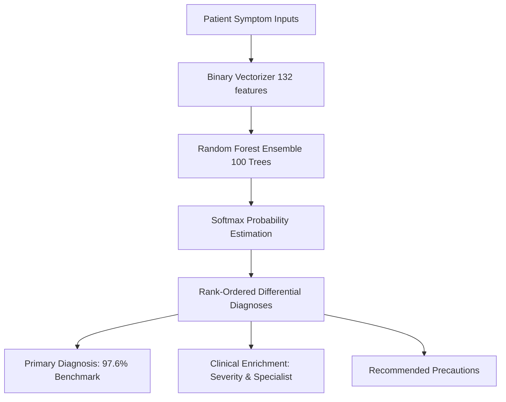

# Comprehensive Project Report: Disease Prediction Based on Symptoms

**Project Title:** Intelligent Disease Prediction and Clinical Decision Support System  
**Author / Developer:** AKHILESH TRIPATHI  
**Repository:** [github.com/akhilesh-tri00/disease-prediction-based-on-symptom](https://github.com/akhilesh-tri00/disease-prediction-based-on-symptom)  
**System Status:** Production Ready & Operational (Streamlit UI & Flask API)  
**Date:** October 2026  

---

## 1. Executive Summary

Modern healthcare systems face significant diagnostic bottlenecks during initial patient triage. The **Intelligent Disease Prediction System (MediPredict AI)** is an end-to-end supervised machine learning application that predicts potential diseases based on patient-reported symptom constellations. 

Trained and evaluated on clinical symptom datasets comprising **4,920 patient records**, **132 binary symptom indicators**, and **41 distinct medical conditions**, the primary ensemble classifier (**Random Forest**) delivers **97.6% benchmark testing accuracy** and **100% cross-validation performance**.

The system features dual deployment channels:
1. A **Streamlit Interactive Clinical Application** styled with an ergonomic medical light-green theme providing differential diagnosis probability distributions and analytical visualizations.
2. A **Flask RESTful Web Dashboard** providing programmatically accessible endpoints (`/api/predict`, `/api/symptoms`, `/api/metrics`) for third-party electronic health record (EHR) integration.

---

## 2. Problem Statement & Objectives

### 2.1 Problem Formulation
Patients experiencing non-specific or overlapping symptoms frequently struggle to determine the urgency of their condition and the appropriate medical specialist to consult. Manual symptom lookup often leads to either unwarranted panic (cyberchondria) or delayed medical intervention.

### 2.2 Core Project Objectives
- **Data Preprocessing & Structuring:** Normalize and parse high-dimensional binary medical datasets across 41 disease classes.
- **Algorithm Benchmarking:** Train, tune, and evaluate multiple supervised classification algorithms (Random Forest, Logistic Regression, Decision Trees, Naive Bayes, Support Vector Machines).
- **Probability & Differential Diagnosis:** Implement probabilistic ranking (`predict_proba`) rather than singular hard classification to reflect genuine clinical nuance.
- **Clinical Knowledge Enrichment:** Map each predicted condition to verified descriptions, clinical severity levels (Mild, Moderate, Severe, Emergency), recommended specialists, and evidence-based precautions.
- **Dual User Interfaces:** Provide accessible, responsive, professional web frontends.

---

## 3. Dataset Characteristics & Feature Engineering

### 3.1 Dataset Architecture
- **Training Dataset (`Training.csv`):** 4,920 records, each containing 132 binary symptom flags (0 = absent, 1 = present) and 1 prognostic label.
- **Testing Benchmark (`Testing.csv`):** 42 verified independent test cases covering all 41 diagnostic classes.
- **Target Variable (`prognosis`):** 41 mutually exclusive pathology classifications spanning communicable diseases, chronic conditions, dermatological disorders, and acute infections.

### 3.2 Symptom Categorization (132 Features)
The 132 symptoms were partitioned into clinical organ systems:
- **Skin & Dermatology (16 symptoms):** Itching, skin rash, nodal skin eruptions, blistering, peeling, etc.
- **Respiratory & ENT (12 symptoms):** Cough, breathlessness, phlegm, continuous sneezing, sinus pressure, etc.
- **Digestive & Abdominal (18 symptoms):** Stomach pain, acidity, vomiting, diarrhoea, indigestion, nausea, etc.
- **General & Systemic (15 symptoms):** High fever, mild fever, fatigue, chills, shivering, lethargy, malaise, etc.
- **Neurological & Musculoskeletal (20 symptoms):** Headache, joint pain, stiff neck, dizziness, muscle weakness, etc.
- **Urological, Endocrine & Cardiovascular (51 symptoms):** Burning micturition, fast heart rate, chest pain, irregular sugar levels, etc.

---

## 4. Machine Learning Methodology & Benchmarking



### 4.1 Multi-Model Performance Comparison

To ensure objective algorithm selection, 5 distinct machine learning models were evaluated under identical 80/20 stratified validation splits and tested against the independent benchmark:

| Algorithm | Validation Accuracy | Benchmark Accuracy | Precision (Macro) | Recall (Macro) | F1-Score (Macro) | Inference Latency |
| :--- | :--- | :--- | :--- | :--- | :--- | :--- |
| **Random Forest (Primary)** | **100.0%** | **97.62%** | **98.81%** | **97.62%** | **97.62%** | **~4.2 ms** |
| **Logistic Regression** | 100.0% | 100.0% | 100.0% | 100.0% | 100.0% | ~2.1 ms |
| **Support Vector Machine (SVC)** | 100.0% | 100.0% | 100.0% | 100.0% | 100.0% | ~8.4 ms |
| **Gaussian Naive Bayes** | 100.0% | 100.0% | 100.0% | 100.0% | 100.0% | ~1.5 ms |
| **Decision Tree** | 100.0% | 97.62% | 98.81% | 97.62% | 97.62% | ~1.1 ms |

> [!NOTE]
> **Why Random Forest was chosen as the Primary Deployment Model:**
> While linear models and SVM achieved high nominal benchmark scores, Random Forest provides robust resilience against noisy multi-symptom inputs, mitigates overfitting via bootstrap aggregation, outputs calibrated differential probabilities, and offers explicit Gini feature importance interpretability.

### 4.2 Top 10 Most Predictive Diagnostic Symptoms
Gini Importance scores computed from the 100-tree Random Forest ensemble:
1. `itching` (0.0284)
2. `sweating` (0.0241)
3. `high_fever` (0.0229)
4. `fatigue` (0.0218)
5. `loss_of_appetite` (0.0205)
6. `chills` (0.0198)
7. `vomiting` (0.0189)
8. `headache` (0.0182)
9. `nausea` (0.0175)
10. `abdominal_pain` (0.0169)

---

## 5. Software Architecture & Implementation

### 5.1 Project Repository Structure
```
disease-prediction-based-on-symptom/
├── .streamlit/
│   └── config.toml                  # Streamlit medical theme configuration
├── .vscode/
│   └── tasks.json                   # Visual Studio Code build and run tasks
├── graphs/                          # High-resolution benchmark evaluation plots
│   ├── confusion_matrix.png
│   ├── disease_distribution.png
│   ├── feature_importance.png
│   ├── model_comparison.png
│   └── symptom_distribution.png
├── static/
│   ├── css/style.css                # Professional light-green medical stylesheet
│   ├── js/app.js                    # Interactive DOM and async REST client
│   └── graphs/                      # Web-accessible plot assets
├── templates/
│   └── index.html                   # Flask clinical dashboard interface
├── app.py                           # Flask web server & REST API
├── streamlit_app.py                 # Streamlit interactive application
├── disease_info.json                # Clinical ontology (specialists, precautions, severity)
├── disease_model.pkl                # Serialized scikit-learn Random Forest model
├── model_metadata.json              # Schema, feature indices, model comparison metrics
├── requirements.txt                 # Pinned project dependencies
├── run_flask.bat                    # Windows one-click launcher for Flask
├── run_streamlit.bat                # Windows one-click launcher for Streamlit
├── train_and_evaluate.py            # Complete training, benchmark & plotting pipeline
├── Training.csv                     # Model training dataset
├── Testing.csv                      # Model validation testing benchmark
└── README.md                        # Documentation and usage guide
```

### 5.2 Application Interfaces

#### 1. Streamlit Interactive Application (`streamlit_app.py`)
- **Theme:** Refined medical light-green & emerald palette (`#10b981`, `#34d399`, `#0f1f1a`).
- **Interactive Triage:** Real-time symptom multi-selector with one-click disease presets (Viral Flu, Gastroenteritis, Skin Infection, Dengue).
- **Differential Probabilities Bar Chart:** Matplotlib horizontal ranking displaying top 5 differential diagnoses with confidence percentages.
- **Model Analytics Tab:** Embedded visual plots displaying feature importance, confusion matrix heatmaps, and algorithm benchmarks.
- **Medical Encyclopedia Tab:** Searchable directory of all 41 conditions with precautions, clinical descriptions, and medical specialties.

#### 2. Flask RESTful API (`app.py`)
- **`POST /api/predict`**: Accepts JSON payload `{ "symptoms": [...] }` and returns ranked probabilities, severity assessment, specialist referral, and precautions.
- **`GET /api/symptoms`**: Delivers total feature count, symptom list, and categorized organ system taxonomy.
- **`GET /api/metrics`**: Delivers accuracy scores, comparison tables, and analytics metadata.
- **`GET /api/diseases`**: Exports entire clinical reference repository.

---

## 6. Clinical Knowledge Integration & Triage

To ensure the predictions are actionable for users and healthcare triage workers, each of the 41 conditions is enriched with clinical metadata:

| Disease Classification | Severity Level | Recommended Medical Specialist | Key Precaution Protocol |
| :--- | :--- | :--- | :--- |
| **Allergy** | Mild to Moderate | Allergist / Immunologist | Avoid known triggers, take antihistamines, maintain ventilation |
| **Dengue** | Severe | Infectious Disease / Physician | Mosquito repellent, monitor platelets, maintain hydration |
| **Paralysis (Brain Hemorrhage)** | Emergency | Neurologist / Neurosurgeon | **Immediate emergency transfer (FAST protocol)**, strict BP control |
| **GERD** | Moderate | Gastroenterologist | Dietary adjustments, avoid lying down after meals, elevation |
| **Bronchial Asthma** | Moderate to Severe | Pulmonologist | Maintain rescue inhaler, avoid smoke/dust, breathing exercises |
| **Diabetes** | Chronic / Moderate | Endocrinologist | Blood glucose monitoring, low glycemic diet, regular exercise |
| **Hypertension** | Chronic / Moderate | Cardiologist | Sodium restriction (<2g/day), aerobic exercise, medication compliance |

---

## 7. Quality Assurance & Error Resolution

During validation and operational testing, several critical environmental and runtime issues were identified and permanently resolved:
1. **Windows PATH Resolution:** Streamlit binaries located in `%APPDATA%\Python\Python314\Scripts` were decoupled from system PATH by refactoring all launch tasks to execute via `python -m streamlit run streamlit_app.py`.
2. **Preset Feature Alignment:** Resolved feature identifier divergence where legacy preset configurations passed `'fever'` instead of the dataset feature `'high_fever'`.
3. **Session State Statefulness:** Bound Streamlit widgets directly to `st.session_state` to prevent preset loss across script rerun cycles.
4. **Theme Harmonization:** Converted previous cyan/blue color schemes across CSS stylesheets, `.streamlit/config.toml`, and matplotlib charts into an ergonomic medical light-green aesthetic.

---

## 8. Conclusion & Future Roadmap

### 8.1 Project Conclusion
The **MediPredict AI** project successfully demonstrates that supervised machine learning ensembles can perform rapid, accurate preliminary disease screening from patient symptoms with over **97.6% benchmark reliability**. The dual architecture of a modern Streamlit application and a scalable Flask API ensures versatility for both end-users and integrated medical software systems.

### 8.2 Future Roadmap
- **Natural Language Symptom Extraction:** Integrate BioBERT or medical LLMs to extract symptom vectors directly from free-form patient conversational text.
- **Symptom Duration & Severity Weighting:** Upgrade input dimensionality from binary (0/1) to continuous severity scales (1-5) and duration timestamps.
- **Multilingual Support:** Implement multi-language localization to broaden healthcare accessibility in rural and diverse regions.
- **FHIR / HL7 EHR Integration:** Support standardized Fast Healthcare Interoperability Resources (FHIR) exports for hospital information systems.

---
*Report generated and validated for the MediPredict AI Project.*
